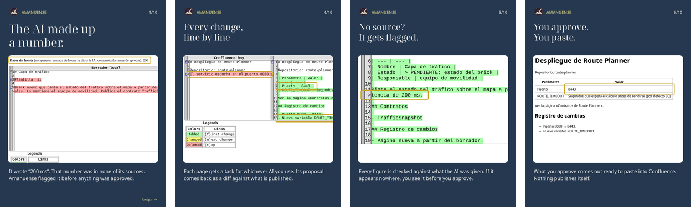

<div align="center">

<picture>
  <source media="(prefers-color-scheme: dark)" srcset="assets/logo-dark.png">
  
</picture>

<p>
<em>An <strong>amanuense</strong> is the scribe who takes dictation and copies it out clean.<br>
They do not decide what the text says. They keep it straight, and they note who said what.</em><br>
<strong>This is that scribe for MIND, the team's Confluence in the Atlassian suite: it compares the published pages<br>with your drafts and your code, prepares one AI-ready task per page, keeps a log of who changed what,<br>and turns the whole space into an Obsidian vault.</strong>
</p>

<p>
  
  
  
  
  
  
</p>

<a href="#-install"><strong>Install</strong></a> ·
<a href="#-your-first-run-step-by-step"><strong>First run</strong></a> ·
<a href="#-the-workshop"><strong>The workshop</strong></a> ·
<a href="#-who-changed-what"><strong>Who changed what</strong></a> ·
<a href="#-ask-for-a-change"><strong>Ask for a change</strong></a> ·
<a href="#-mind--obsidian"><strong>MIND → Obsidian</strong></a> ·
<a href="#-pick-your-ai"><strong>Pick your AI</strong></a> ·
<a href="#-the-team-repo"><strong>The team repo</strong></a> ·
<a href="#-companion-obsidian-search"><strong>Companion</strong></a> ·
<a href="#-why-this-exists"><strong>Why</strong></a> ·
<a href="#-roadmap"><strong>Roadmap</strong></a> ·
<a href="#-status"><strong>Status</strong></a>

</div>

---

https://github.com/user-attachments/assets/6e89da5c-3f9d-4384-8f5f-3160effc1a8e

<div align="center"><sub>Narrated demo (Spanish, 85 s). Made-up space, people and repo; the AI answers are scripted
so the take is reproducible. Rebuild it with <code>scripts/render-assets.sh demo</code>.</sub></div>

<p align="center"><a href="assets/linkedin/amanuense-carousel-en.pdf"></a></p>

<div align="center"><sub>The same flow in ten slides: <a href="assets/linkedin/amanuense-carousel-en.pdf">English</a> ·
<a href="assets/linkedin/amanuense-carousel-es.pdf">Spanish</a> (PDF). Built from real screenshots with
<code>assets/linkedin/build-carousel.py</code>.</sub></div>

---

## ⬇ Install

It needs Python 3.11 and nothing else. There is no setup step and no dependency.

```sh
git clone git@github.com:gitsual/amanuense.git
cd amanuense
./amanuense.sh          # first run creates ~/docs-workshop and tells you what to drop in it
```

> [!NOTE]
> The workshop speaks English by default: folders, reports and the AI prompts. Run it once with
> `--lang es` (or set `AMANUENSE_LANG=es`) for a Spanish workshop; a workshop that already has
> Spanish folders stays Spanish. The step-by-step guide is [docs/guide.md](docs/guide.md)
> ([en español](docs/guia.md)).

<details>
<summary><strong>Windows 11</strong></summary>

Install [Python](https://www.python.org/downloads/windows/) and tick *Add python.exe to PATH*.
Then double-click `amanuense.bat`. The first run creates `Documents\docs-workshop` and opens it.
Every later double-click analyses the folder and opens `output\index.html`.

</details>

<details>
<summary><strong>As a package</strong></summary>

```sh
pip install -e .        # gives you the `amanuense` command
amanuense init ~/docs-workshop
amanuense run ~/docs-workshop --ai-cli claude
```

</details>

## 🚀 Your first run, step by step

A walkthrough for Windows that takes about ten minutes. The video at the top shows the same flow.

1. Clone the repo with Fork or Git Bash: `git clone https://github.com/gitsual/amanuense.git`
2. Install [Python 3.11+](https://www.python.org/downloads/windows/) and tick *Add python.exe to PATH*.
3. Double-click `amanuense.bat`. It creates `Documents\docs-workshop` and opens it.
4. Fill its folders:
   - `1-confluence-export`: in MIND, open the page's «···» menu and choose Export → Export to Word →
     *This page and its children*.
   - `2-my-docs`: your drafts. A draft that replaces a page keeps the page's title and has a
     paragraph that starts with `Update instructions:`.
   - `3-bible`: what overrides everything else, such as the reference architecture, the Nexus
     requirements and the repo standards.
5. Double-click again. `output\index.html` opens with the report: pages to update, new pages,
   duplicates and leftovers.
6. Every page gets a `TASK.md`. Give it to the AI your company allows, and save the answer as
   `RESULT.md` in the same folder. If Copilot CLI is installed, run `amanuense.bat --ai-cli copilot`
   and it does this step for you.
7. Double-click again. Review `CHANGES.html`; its top lists data the AI may have made up. Then open
   `FOR-CONFLUENCE.html`, select all, copy and paste it into MIND.

From there:

- **Who changed what:** replace the export with a newer one and run again. `output\log.html`
  logs the changes. To see authors, put a personal MIND token in a local `.env`; it never leaves your machine.
- **Code changes:** list your Bitbucket clones in `repos.txt`. The log flags pages that a commit outdates.
- **Team requests:** add lines like `- Name: what to change` to `requests.md`. The AI picks the
  page and prepares its task.
- **Obsidian:** `amanuense.bat obsidian "path\to\export.docx" "path\to\vault\MIND"`.

Nothing is uploaded anywhere. Nothing reaches MIND until a person has reviewed it and pasted it.

## 📝 The workshop

```
docs-workshop/
  1-confluence-export/   the Word export of the section (page + children)
  2-my-docs/             your drafts: new pages, and old ones with "Update instructions:"
  3-bible/               what overrides everything: reference architecture, standards
  requests.md            change requests, one line each
  repos.txt              local clones of the code repos
  output/                report, one task folder per page, the change log
```

Each run:

1. Compares the export with your drafts and writes a report. It lists what to update, what is new,
   what is duplicated and which Confluence pages have no local counterpart.
2. Writes a `TASK.md` per page. The file carries the rules, the instructions, the current page,
   the template skeleton and the bible. You can give it to any AI.
3. Turns every `RESULT.md` it finds into two pages. `FOR-CONFLUENCE.html` is ready to copy and
   paste. `CHANGES.html` is the diff you approve.
4. Flags **data without a source**: figures, versions, acronyms or names in the result that appear
   nowhere in what the AI was given.

It never writes into the input folders and never overwrites a `RESULT.md`.

The Spanish workshop (`--lang es`) uses `1-export-confluence/`, `2-mi-documentacion/`, `3-biblia/`,
`peticiones.md`, `salida/`, `TAREA.md` and `RESULTADO.md`, and the marker
`Instrucciones de actualización:`. Both markers work in either language.

## 👥 Who changed what

To update, download the newest Word export and drop it in place of the old one. `output/log.html` then
records four kinds of change:

| Source | What | Who |
| --- | --- | --- |
| Confluence | lines added and removed per page since the previous export | author, date and version comment from the REST API |
| Code | commits in the clones listed in `repos.txt`, and the pages that mention the touched files | the commit author |
| Requests | the page the AI picked, what to change and why | whoever wrote the request |
| Workshop | proposals ready for review | whoever ran the workshop |

The Word export carries no authors, so the "who" for Confluence comes from the API. To enable it,
put a personal access token in a local `.env`:

```
AMANUENSE_CONFLUENCE_URL=https://your-confluence
AMANUENSE_CONFLUENCE_TOKEN=...
AMANUENSE_CONFLUENCE_SPACE=SPACEKEY
```

Data Center uses the token as a Bearer token on `/rest/api`. Cloud also needs
`AMANUENSE_CONFLUENCE_USER` and uses `/wiki/rest/api`. Without a token the log still records what
changed, but not who changed it.

## ✋ Ask for a change

Add a line to `requests.md`:

```
- Ana: the deployment port is now 8443
```

On the next run, the AI reads the request and the list of pages. It answers which page to change,
what to change and why, and the workshop prepares that page's task under `output/requests/`.
If the AI names no valid page, the request is retried on the next run.

## 🪨 MIND → Obsidian

The same Word export becomes an Obsidian vault, so the whole space can be read and linked offline:

```sh
./amanuense.sh obsidian ~/docs-workshop/1-confluence-export/MIND.docx ~/vault/MIND
amanuense.bat obsidian EXPORT.docx VAULT\MIND      # Windows
```

Root pages (H1) become folders with an `_index.md`, child pages (H2) become notes, and a child with
its own children (H3) becomes a folder too. Images land in `_media/` as `![[...]]` embeds, and every
index links its children. It refuses to overwrite existing notes unless you pass `--force`.
`assets/obsidian/letravora.css` is the CSS snippet used in the video.

## 🤖 Pick your AI

| Flag | Engine |
| --- | --- |
| `--ai-cli claude` | Claude Code (`claude -p`) |
| `--ai-cli codex` | Codex (`codex exec`, read-only sandbox) |
| `--ai-cli gemini` | Gemini CLI |
| `--ai-cli copilot` | GitHub Copilot CLI |
| `--ai-url URL --ai-model M` | any OpenAI-compatible API (Ollama, LM Studio, vLLM) |

The prompt always goes to the engine on stdin, and each call runs in an empty temporary folder.
With no AI configured, you paste each `TASK.md` into a chat yourself.

## 🗂 The team repo

`src/amanuense/skeleton/en/` (or `es/`) is a starting point for the team's documentation repo. It
holds the bible, the shared docs, one agent and three skills. Write the skills and agents once, then run
`amanuense agents PATH` to generate the native files for each tool: `.claude/`, `.agents/`,
`.codex/`, `.gemini/` and `.github/agents/`.

## 🔗 Companion: obsidian-search

[obsidian-search](https://github.com/gitsual/obsidian-search) is a local semantic search engine.
When both are installed in the same Python, `--content` uses its embeddings to match renamed pages
and duplicated content, and `--contradictions` uses its NLI judge to find sentences that contradict
each other. Without it, everything else works.

## 💡 Why this exists

| | Confluence alone | A chat with the AI | amanuense |
| --- | --- | --- | --- |
| Drafts vs published pages | by hand | paste both, every time | report on every run |
| Who changed a page | page history, one page at a time | no | log across all pages |
| Code changes that outdate a page | no | no | flagged per commit |
| Invented data | n/a | you have to spot it | flagged before you approve |
| Your documents leave the machine | n/a | yes | only to the AI you choose |

## 🧭 Roadmap

What the team asked for, and where each piece stands.

| Goal | Status |
| --- | --- |
| Less, coherent documentation: duplicates and orphan pages flagged | done: report on every run |
| Confluence vs local drafts, with one source of truth | done: report, diff and paste-ready page |
| Know who changed what, in Confluence and in code | done: change log; authors need the REST API |
| Change requests in plain words, routed to the right page | done: `requests.md` |
| A bible that overrides everything (reference architecture, requirements, repo standards) | done: `3-bible/`, fed to every task |
| MIND readable and linkable offline | done: `amanuense obsidian` |
| A shared team repo with docs, agents and skills | done: skeleton plus `amanuense agents` |
| Skills that produce designs ready to paste into Confluence | partial: the workshop skills; design skills planned |
| A guide on when to use an agent and when a skill | planned |
| Teams bots per role that update Confluence only after their owner approves | planned |
| Workflows over the real Bitbucket repos | planned: today it reads local clones |
| Runs on the team's Windows laptops, next to Git Bash and Fork | done: double-click launcher, tested on Windows 11 |

Nothing connects your AI to the company on its own. You choose the engine, and every change to
Confluence is pasted by a person after reviewing the diff.

## 📍 Status

- **Tested:** the whole suite on Linux and on Windows 11. On Windows that includes a double-click
  run and a request routed through a local Ollama. Claude Code and Codex were run live as
  engines on Linux.
- **Not tested yet:** the Confluence API against a real server. It is covered by a fake that
  answers like Data Center. Gemini CLI and Copilot CLI have not been tested live.
- The Confluence API only answers from inside your organisation's network. The log runs fine
  without it.

## License

MIT
