<div align="center">

<picture>
  <source media="(prefers-color-scheme: dark)" srcset="assets/logo-dark.png">
  
</picture>

**Keeps a team's Confluence in step with its drafts and its code.**<br>
It finds what is out of date, has the AI of your choice write the fix, flags anything the AI made up,<br>
and lets a person review, approve and publish every page from a small app on their own machine.

[](https://github.com/gitsual/amanuense/actions/workflows/ci.yml)


[What it does](#what-it-does) ·
[Install](#install) ·
[First run](#first-run) ·
[Review and publish](#review-and-publish) ·
[Change log](#the-change-log) ·
[Radar](#the-radar-a-pass-every-morning) ·
[AI engines](#ai-engines) ·
[Configuration](#configuration) ·
[Status](#status)

</div>

<p align="center"><a href="assets/video/demo-en.mp4"></a></p>

<p align="center"><sub>Narrated demo: <a href="assets/video/demo-en.mp4">English</a> · <a href="assets/video/demo-es.mp4">Spanish</a> (about 3 min).
Everything in it is made up: the team, the people, the repos, Confluence and the AI's answers all run on one machine against
<a href="demo/fakes.py"><code>demo/fakes.py</code></a>. Rebuild it with <code>scripts/render-assets.sh demo [es]</code>.</sub></p>

---

## What it does

Documentation drifts. A page says alerts are kept for 24 hours; a commit merged yesterday keeps them for 72;
someone asked in the chat for a different behaviour and nobody wrote it down. amanuense watches the three
sources a team actually changes and turns the gaps into reviewed edits:

| Source | What amanuense does with it |
| --- | --- |
| **Confluence** (its "Export to Word") | Compares every page with your drafts: what to update, what is new, duplicated, contradictory, or only in Confluence. With an API token it also records who changed each page and when. |
| **Your drafts** (`.docx`, `.md`, `.txt`) | A draft with the same title and an `Update instructions:` paragraph updates that page; anything else becomes a new page, optionally on the team template. |
| **Code** (the repos in `repos.txt`) | Follows the branches you choose. When a commit touches something a page talks about, the AI triages it (update, chain onto another proposal, noise or doubtful) and drafts the new text from the diff. |
| **Requests** (`requests.md`) | `- Samir: alerts must reach the boards within 30 seconds`. The AI picks the page, and the request becomes one more proposal. |

Every proposal then goes through the same path:

1. **One task per page** (`TASK.md`) with the rules, the current page, the sources and the team's "bible", ready for any AI.
2. **The AI writes `RESULT.md`**, either automatically (an agent CLI or a local model) or by you pasting the task into a chat.
3. **Unsourced data is flagged**: figures, versions, names or identifiers that appear in none of the inputs are listed before anyone approves.
4. **A person reviews it** in the review app, side by side with what Confluence has today, resolves every `CONFLICT`, and approves or discards it.
5. **It is published** by hand (copy and paste) or through the Confluence REST API, with a backup and an undo.

Around that core:

- **A change log** of what changed in Confluence, in the code and in the workshop, and who did each thing.
- **A capability radiator** that reads every branch of every repo, compares versions with your npm registry and links each package to the pages that cite it.
- **A delivery** folder or zip for when someone else publishes.
- **A radar** script that runs a pass unattended every morning and keeps a snapshot history in Git.
- **An Obsidian vault** from the same Word export, one note per page.
- **A team repo skeleton** with shared docs, agents and skills for Claude Code, Copilot, Codex and Gemini.

<table>
<tr>
<td width="50%">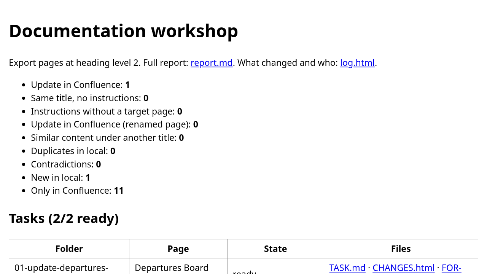<br><sub>The report of a run.</sub></td>
<td width="50%">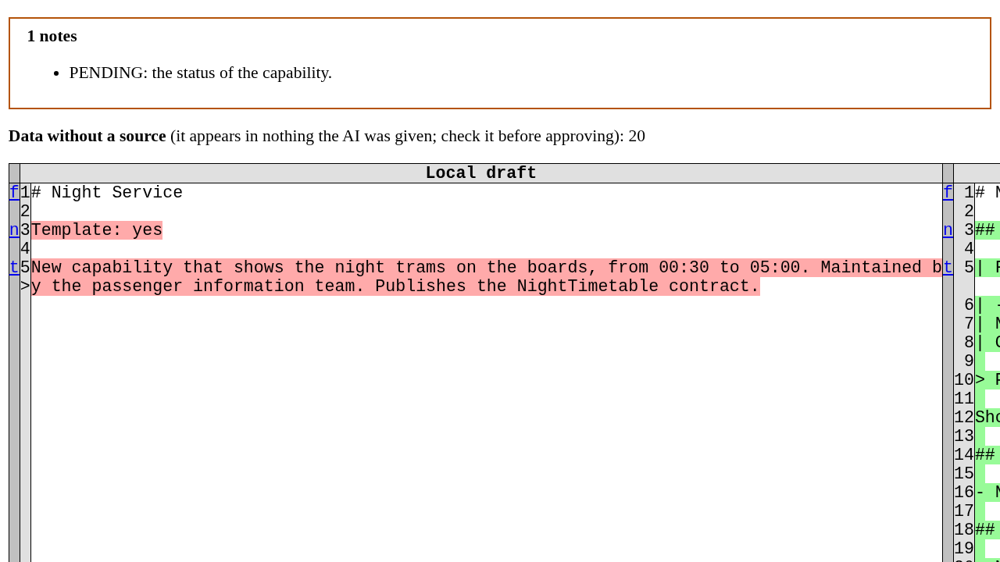<br><sub>A figure the AI made up, flagged before review.</sub></td>
</tr>
<tr>
<td>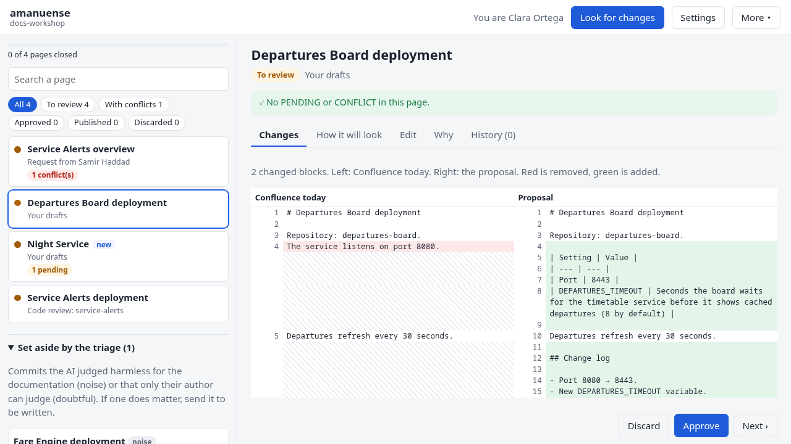<br><sub>The review app: inbox, set-aside commits and the diff.</sub></td>
<td>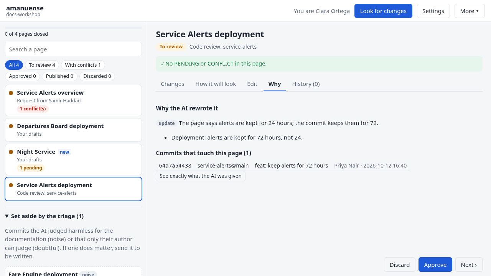<br><sub>Why the AI changed a page, down to the commit.</sub></td>
</tr>
<tr>
<td>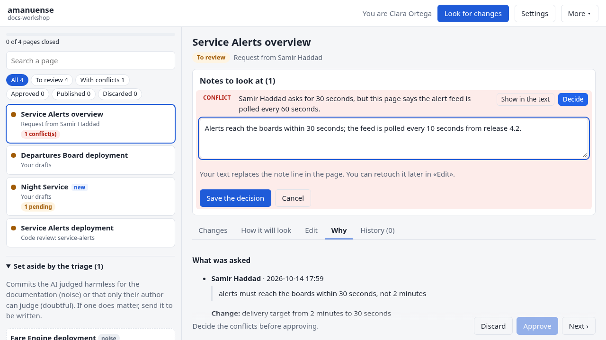<br><sub>A conflict blocks approval until a person decides.</sub></td>
<td>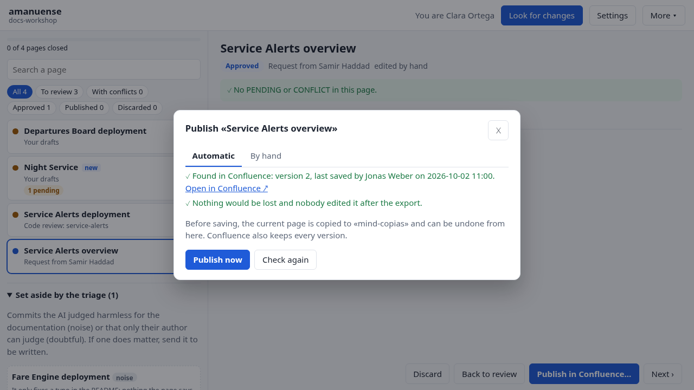<br><sub>Checks before publishing.</sub></td>
</tr>
</table>

<details>
<summary><strong>More screenshots</strong>: code review diff, published page, change log, radiator, radar, Obsidian</summary>

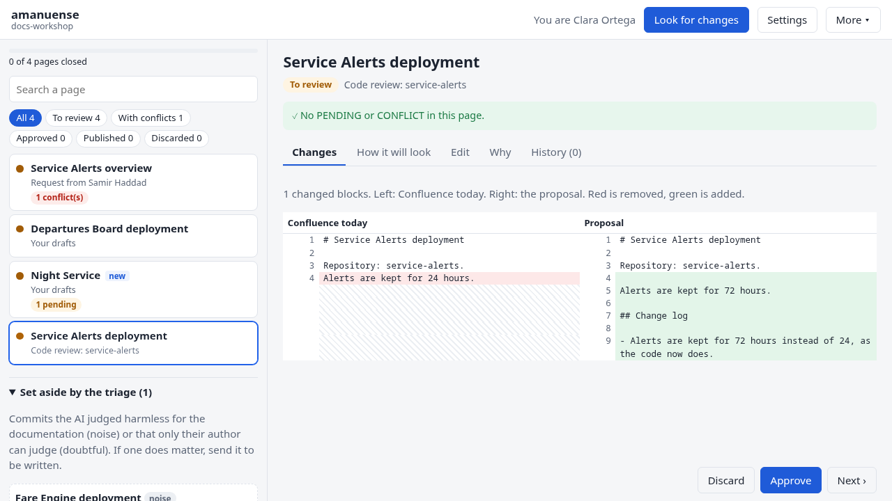
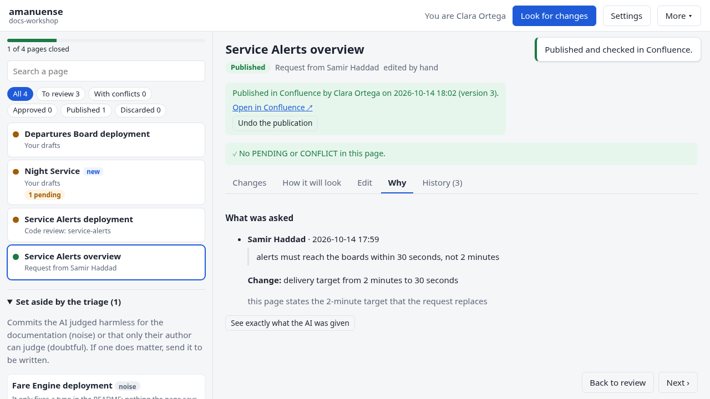
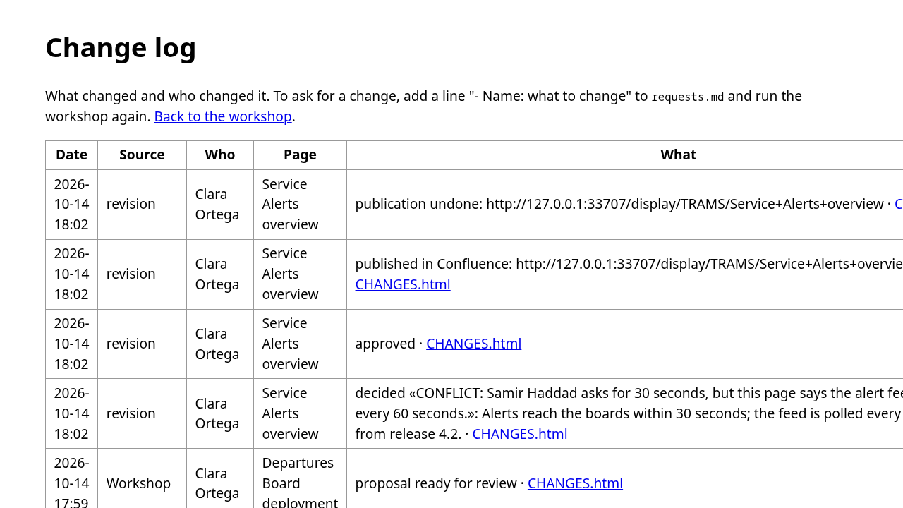
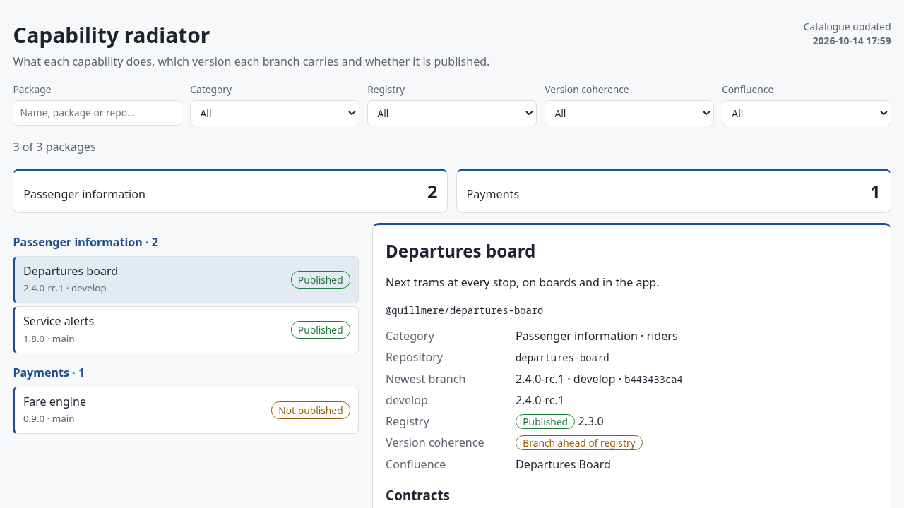
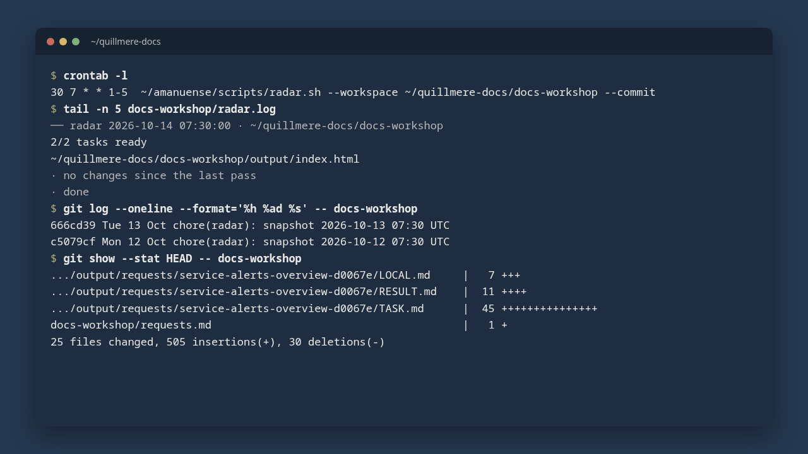
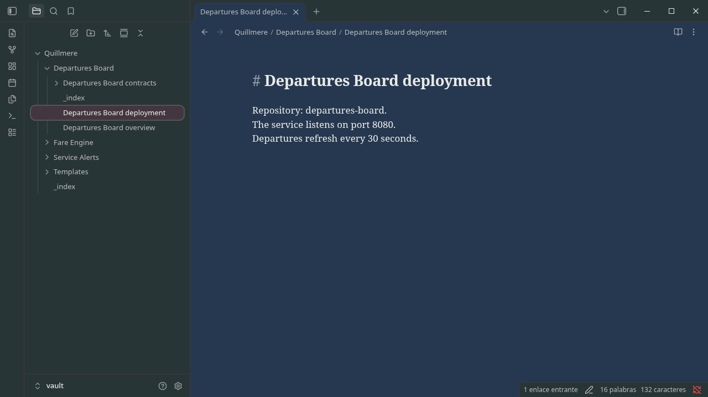

</details>

## Install

amanuense needs **Python 3.11 or newer** and nothing else: the core uses only the standard library.
Git is needed only to follow code repos.

**Windows 11.** Install [Python](https://www.python.org/downloads/windows/) (ticking *Add python.exe to PATH*
helps, but the launcher finds Python without it). Clone or download this repo and double-click **`amanuense.bat`**.
The first run creates `Documents\docs-workshop` and opens it. If a folder in a path has brackets,
quote the path in the terminal.

**Linux and macOS.**

```sh
git clone https://github.com/gitsual/amanuense.git
cd amanuense
./amanuense.sh            # the first run creates ~/docs-workshop
```

**As a package** (any OS):

```sh
pip install -e .          # gives you the `amanuense` command
amanuense init ~/docs-workshop
amanuense run ~/docs-workshop --ai-cli claude
```

The workshop speaks English by default. `--lang es` (or `AMANUENSE_LANG=es`) creates a Spanish one;
an existing workshop keeps its own language. The full guide is [docs/guide.md](docs/guide.md)
([en español](docs/guia.md)).

## First run

The workshop is a plain folder:

```
docs-workshop/
├── 1-confluence-export/   the Word export of the space (page "···" → Export → Export to Word → this page and its children)
├── 2-my-docs/             your drafts (.docx, .md, .txt)
├── 3-bible/               what overrides everything; a file with "template" in its name is the template for new pages
├── repos.txt              optional: code repos and branches to follow
├── requests.md            optional: "- Name: what to change"
└── output/                everything amanuense writes
```

1. Drop the export and your drafts in. A draft that replaces a page has **the same title** and a
   paragraph starting with `Update instructions:`. A new page that must follow the template has the
   line `Template: yes`.
2. Run the launcher again. The review app opens; press **Look for changes**.
3. With an AI configured ([AI engines](#ai-engines)) the proposals are written for you. Without one,
   give each `output/tasks/*/TASK.md` to your AI and save its answer as `RESULT.md` next to it.
4. Review, approve and publish each page in the app.

Running it again is safe: it never touches your input folders and never overwrites a `RESULT.md`.
Step by step: [docs/guide.md](docs/guide.md#try-it-in-five-minutes-windows).

## Review and publish

`amanuense.bat` / `./amanuense.sh` with no arguments, or `amanuense review <workshop>`, opens the review app.
It is a local page served on `127.0.0.1`, works offline and needs no installation.

- **Inbox**: one row per page with its origin (your drafts, a request and who asked, or a code review),
  its notes and its state (to review, approved, published, discarded), with filters and a progress bar.
  Commits the triage set aside as noise or doubtful are folded below with the reason; **Write it anyway**
  sends one to the AI.
- **Five tabs per page**: **Changes** (side by side with Confluence), **How it will look**, **Edit**
  (Markdown with live preview; the AI's version is kept as `RESULT.ia.md`), **Why** (the request or the
  exact commits, and what the AI was given) and **History** (who changed the page in Confluence).
- **Notes**: every `PENDING` and `CONFLICT` is listed on top. **Decide** replaces a conflict with your
  text; a page cannot be approved while one is open. With an AI configured you can ask it to rework a page.
- **Discard** with a reason, **Approve**, **Next**. If Confluence changes after you approve, the page
  goes back to review.

**Add documentation.** Drop files or whole folders (10 or a few thousand) on **Add documentation**.
Before anything is uploaded the app shows what it will use and what it sets aside: exact copies,
noise (`node_modules/`, `build/`, logs… adjust it in `intake-ignore.txt`), empty files and formats it
cannot read (PDF, images). It reads `.md`, `.markdown`, `.txt`, `.docx`, `.html` and `.htm`. The files
land in `2-my-docs/intake-<date>/` and are compared with the **current** Confluence space, read live
through the API when Confluence is configured (otherwise with the Word export); the app says which
source it used. Files with no matching page are ranked as candidates for a new page.

<p align="center"><a href="assets/video/intake-en.mp4">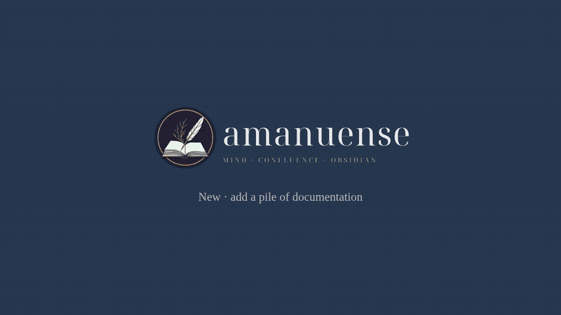</a></p>

<p align="center"><sub>Narrated demo: <a href="assets/video/intake-en.mp4">English</a> · <a href="assets/video/intake-es.mp4">Spanish</a> (about 90 s).
Made up like the one above. Rebuild it with <code>scripts/render-assets.sh intake [es]</code>.</sub></p>

**Publishing.** *By hand* always works: copy the formatted page, paste it into Confluence, mark it
published. *Automatically*, with a Confluence address, space and personal token in **Settings**:

- it **blocks** if the page changed in Confluence after your export, and says who changed it and when;
- it **blocks** if the page holds something it cannot rebuild (images, attachments, macros, mentions)
  and switches to the guided manual mode, listing what would be lost;
- it saves the current version first (`output/mind-copias/`), writes the page, reads it back and only
  marks it published if the version matches;
- **Undo** puts the saved copy back as a new version.

Details and the remaining safeguards: [docs/guide.md](docs/guide.md#publishing).

### Inside another web app (optional)

The review screens can live in a FastAPI host instead of their own page. That needs an extra; the core
install and `amanuense review` stay free of dependencies and unchanged.

```bash
pip install 'amanuense[fastapi]'
```

```python
from fastapi import FastAPI
from amanuense import api

app = FastAPI()
api.install(app, "/path/to/workshop")   # adds /api/amanuense/*
```

`install` raises `FileNotFoundError` if the folder does not exist and `RuntimeError` if the app already
has a workshop. It never writes to the folder on install. It reads: `GET /state`, `/page?rel=`,
`/job`, `/task?rel=` and `POST /preview` (Markdown to HTML, 2 MB at most). It reviews with `POST /save`
(`{rel, markdown}`), `/resolve` (`{rel, notice, decision}`), `/approve`, `/reopen` (`{rel}`) and `/discard`
(`{rel, reason}`), each answering with the page as `GET /page` shows it (an open conflict makes approve a 409),
and `/promote` (`{rel}` of a set-aside task -> `{ok: true}`). It publishes to MIND with `POST /preflight`
(`{rel, parent?}` -> `{page, parent, blockers, warnings}`; it only reads, so it also runs during a job),
`/publish` (`{rel, parent?, accept_warnings?}`; blockers, or warnings without `accept_warnings`, are a 400 and
change nothing), `/undo` (409 when no publish from here was recorded) and `/mark-published` (`{rel, url}`
for a page published by hand). It also takes documentation in:
`POST /intake/plan` (`{files:[{path,size,sha256}]}`, up to 16 MB), `/intake/start` (-> `{batch, folder}`),
`/intake/file?batch=&path=` (raw `application/octet-stream` body with `X-Content-SHA256`, streamed to disk; `Content-Length` is required, 411 without a valid one, and the bytes received are counted: more than declared is 413, fewer is 400, nothing is kept),
`/intake/cancel` (`{batch}`), `/intake/promote` (`{rel}`) and `POST /job` (`{name, batch?}` with `name` in
`run`, `intake`, `radiator`, `deliver`, `rework`; poll `GET /job`). All need the token; all but the plan, the preflight and
`/job` wait while a job runs (423); an unknown job name is a 400. `POST /vault` (`{confirm: true}`, anything else is a 400
and nothing is touched) rebuilds the vault in the background: it creates the folder, replaces only the MIND, local-docs and
bible subtrees, then calls the host's `on_vault_changed` once; the result is in `GET /job`, and if that callback fails the
vault stays and `result.reindex_error` says why. `GET /artifact/log`, `/artifact/radiator` (HTML, served with
`Content-Security-Policy: sandbox; default-src 'none'; style-src 'unsafe-inline'`, `nosniff` and `no-store`, to open in a
new tab) and `/artifact/delivery` (the newest zip, as an attachment) need no token; anything else, a missing file or a link
that leaves the workshop is a 404. Errors are `{"error": "…"}`
with the same status codes as the review app. It has no route to stop the process or to open a local
program, and `rel` values that leave the workshop are refused.

### Settings from the web app

The router also serves the app's Settings: `GET /settings` (fields, `config_file`, `revision`),
`POST /settings` (`{values, revision?}`), `POST /settings/forget` (`{fields?}`; no `fields` removes every
stored secret) and `POST /settings/test` (the MIND user). Every POST needs the token from `GET /session`;
saving and forgetting wait while a job runs. Each key is resolved as **environment variable, then
`settings.json`, then default**; a key set in the environment is shown read-only and refused on save.
`settings.json` lives in `config_file`: `%APPDATA%\amanuense` on Windows, `~/.config/amanuense` elsewhere
(or `AMANUENSE_CONFIG_DIR`). Passing the `revision` you read makes a save fail with 409 if the file
changed meanwhile; leaving it out is last-writer-wins.

A host that wants the settings to read something other than `os.environ` (for example, one that copies
saved values into its own environment at start and must not have them look like variables the user set)
passes `env=` to `api.install(...)` or `api.install_settings(...)`: a mapping, or a function returning one
(called on every request). Listing, saving and `pending_restart` use it; the host passes the same view to
`settings.boot_snapshot(env)`. Default: `os.environ`.

If the workshop folder is wrong the router cannot start, so a host can call
`api.install_settings(app)` instead: it mounts only `/session` and the settings routes, enough to fix
`workspace`. To recover without the web app, edit `config_file` (or set `AMANUENSE_WORKSPACE`; for a host
switched off with `documentation_enabled=false`, remove that key or set `OBSIDIAN_SEARCH_DOCUMENTATION=1`).
Downgrading to an older amanuense keeps working, but its next save drops the keys added in version 2
(workspace, language, author, AI key and the host's search keys).

`amanuense.api.API_VERSION` is a plain integer that grows whenever a route is added or changes; a host
compares it with the version it was written for and hides the integration when it is lower. This release
is version 2. To turn the labels of the review screens into a host's locale files, see
`scripts/export_ui_texts.py`.

## The change log

Each run updates `output/log.html`:

- **Confluence**: every page that changed since the previous export, with the lines added and
  removed and, with a token, who changed it, when and the version comment.
- **Code**: the commits of the repos in `repos.txt`, with author and branch. A line is a local clone or
  a URL (cloned into `repos/` and fetched on every run); `@ develop, feature/x` follows those branches and
  `@ *` all of them. The first run looks back 90 days.
- **Requests** routed to their page, and **the workshop**: every proposal, approval, discard,
  publication and undo, with the name of who did it.

Pages longer than 40,000 characters are edited with `SEARCH/REPLACE` blocks instead of being rewritten;
an edit that does not apply exactly becomes a `PENDING` note, so nothing is lost silently.
More: [docs/guide.md](docs/guide.md#change-log-what-changed-and-who-did-it).

## The capability radiator

```sh
./amanuense.sh radiator            # or: More → Capability radiator, in the app
```

For every repo in `repos.txt` it reads all branches, takes the version from `package.json` (or
`brick.metadata.json`), asks your npm registry which versions are published and tells whether each
branch is the same, ahead or behind. Each package links to the Confluence pages that cite it.
Output: `output/radiador/index.html`, `catalogo.json` and a page ready to paste into Confluence.
Configure the scope, the registry and the categories in `<workshop>/radiador.json`.

## Hand it over

```sh
./amanuense.sh deliver --zip       # amanuense.bat deliver --zip
```

Gathers every proposal that is not discarded into `output/delivery-DATE/` (`pages/`, `new/`, the
radiator) with a `README.md` that lists where each page came from, which ones only their author can
decide and every open note. `--zip` also zips it. See [docs/guide.md](docs/guide.md#hand-it-over).

## The radar: a pass every morning

[`scripts/radar.sh`](scripts/radar.sh) runs one unattended pass over a workshop: it checks that the
repos are reachable, looks for changes, writes the proposals with the configured AI, rebuilds the
radiator if the workshop has a `radiador.json`, and can commit a snapshot of the workshop to the Git
repo it lives in. It never opens a browser and never asks for a password.

```sh
scripts/radar.sh --workspace ~/team-docs/docs-workshop --commit
scripts/radar.sh --commit --push --deliver -- --ai-cli codex     # anything after -- goes to `amanuense run`
```

| Flag | |
| --- | --- |
| `--workspace DIR` | the workshop (default `AMANUENSE_WORKSPACE`, else `~/docs-workshop`) |
| `--env FILE` | settings file (default the `.env` next to `amanuense.sh`) |
| `--log FILE` | where to append the pass (default `<workshop>/radar.log`) |
| `--commit` | commit `chore(radar): snapshot <date> UTC`, only if something besides timestamps changed |
| `--push` | also push (implies `--commit`; rebases first if the tree is clean) |
| `--deliver` | also build the delivery folder |

Exit codes: `0` done, `1` setup error, `2` bad option, `3` another pass is running, `4` a repo is
unreachable (no VPN, no network: it stops at once and the next pass tries again), `5` push rejected.
The change-log name comes from `AMANUENSE_USER`, else from `git config user.name`.

Schedule it:

- **cron**: `30 7 * * 1-5  ~/amanuense/scripts/radar.sh --workspace ~/team-docs/docs-workshop --commit`
- **systemd** (user timer):

  ```ini
  # ~/.config/systemd/user/amanuense-radar.service
  [Service]
  Type=oneshot
  ExecStart=%h/amanuense/scripts/radar.sh --commit

  # ~/.config/systemd/user/amanuense-radar.timer
  [Timer]
  OnCalendar=Mon..Fri 07:30
  Persistent=true
  [Install]
  WantedBy=timers.target
  ```

  then `systemctl --user enable --now amanuense-radar.timer`.
- **Windows Task Scheduler** through Git Bash:
  `powershell -ExecutionPolicy Bypass -File scripts\schedule-radar.ps1 -At 08:30 -Commit`
  (`-Every weekly`, `-Push`, `-Deliver`, `-Workspace`, `-Remove`; extra `amanuense run` flags after `--`).
  A missed run starts as soon as the laptop is on.

With `--commit` the team repo becomes the history of the documentation: one snapshot per day that
something changed, and `git diff` between any two mornings. Save the Git credentials once by hand
before scheduling it. The older [`scripts/schedule-windows.ps1`](scripts/schedule-windows.ps1) still
schedules a plain `amanuense run` without snapshots.

## AI engines

amanuense never picks an AI for you and works without one: every task is a self-contained
`TASK.md` you can paste into any chat.

| Engine | How | Notes |
| --- | --- | --- |
| Claude Code, Codex, Gemini CLI, Copilot CLI | `--ai-cli claude` (`codex`, `gemini`, `copilot`) or `AMANUENSE_AI_CLI` | must be installed and signed in; each task goes in on stdin and the agent runs in an empty temporary folder |
| Any OpenAI-compatible API (Ollama, LM Studio, vLLM...) | `--ai-url http://localhost:11434/v1 --ai-model qwen3-coder` or `AMANUENSE_AI_URL` / `AMANUENSE_AI_MODEL` (`AMANUENSE_AI_KEY` if needed) | a local model keeps everything on the machine |
| None | paste `TASK.md`, save `RESULT.md` | |

The unsourced-data check works the same with all of them. Use only an AI your organisation allows for
these documents.

## Configuration

Everything is optional. Set it in the environment or in a `.env` next to the launchers (one
`KEY=VALUE` per line, without quotes or spaces in the value; `.env` is git-ignored). The app's
**Settings** keep the Confluence address, space, token and AI in your user folder, never in the
workshop; an environment variable wins over Settings, and `run` (so the radar) reads only the
environment.

| Variable | What |
| --- | --- |
| `AMANUENSE_WORKSPACE` | the workshop folder (default `~/docs-workshop`, `Documents\docs-workshop` on Windows) |
| `AMANUENSE_LANG` | `en` or `es`, for a new workshop |
| `AMANUENSE_USER` | name written in the change log |
| `AMANUENSE_CONFLUENCE_URL`, `_SPACE`, `_TOKEN` | Confluence base address, space key, personal access token |
| `AMANUENSE_CONFLUENCE_USER` | account e-mail, Confluence Cloud only |
| `AMANUENSE_CONFLUENCE_ROOT` | only read the pages under this page ID when comparing |
| `AMANUENSE_AI_CLI` | `claude`, `codex`, `gemini` or `copilot` |
| `AMANUENSE_AI_URL`, `_MODEL`, `_KEY` | an OpenAI-compatible API instead of an agent |
| `AMANUENSE_CONFIG_DIR` | another folder for the app's Settings |
| `RADAR_PROBE_TIMEOUT` | seconds `radar.sh` waits for the first repo (default 60) |

Inside the workshop: `repos.txt`, `requests.md` and `radiador.json`. Full reference:
[docs/guide.md](docs/guide.md#configuration-what-you-can-set-and-where).

## More

- **Obsidian**: `./amanuense.sh obsidian EXPORT.docx ~/Vault/Docs` turns the export into a vault, one
  folder per root page, one note per child, images in `_media/`, linked indexes. `--force` rewrites an
  existing export. Give it the workshop folder instead (`./amanuense.sh obsidian ~/docs-workshop ~/Vault`)
  and it builds the whole vault: `MIND/` from the newest export plus copies of your local docs and the
  bible, so a search tool over the vault sees all three; rerun with `--force` after each new export.
  Only those three folders are rebuilt; `./amanuense.sh vault` (`amanuense.bat vault`) is the shortcut
  for `obsidian WORKSHOP WORKSHOP/vault --force`. A matching theme is in [`assets/obsidian/letravora.css`](assets/obsidian/letravora.css).
  See [docs/guide.md](docs/guide.md#move-mind-to-obsidian).
- **Duplicates by content**: with [obsidian-search](https://github.com/gitsual/obsidian-search)
  installed in the same Python, `--content` also finds renamed pages and duplicates by meaning, and
  `--content --contradictions` looks for sentences that contradict each other. Without it, matching is by title.
- **The team repo**: [`src/amanuense/skeleton/en/`](src/amanuense/skeleton/en/README.md) is a skeleton
  for the team's shared documentation repo, with agents and skills that follow the same rules as the
  workshop. `amanuense agents PATH` writes the native files for each tool.

## Privacy and security

- Everything runs on your machine. Your documents go only to the AI you configure, and an agent CLI
  only sees the task, from an empty temporary folder.
- The review app listens on `127.0.0.1` only, with a per-run token in the URL, Host and Origin checks
  and a strict Content Security Policy.
- The Confluence token is stored in your user folder (encrypted with DPAPI on Windows, mode 600
  elsewhere), is never sent to the browser and never goes into a delivery. Publishing requires `https`
  except to `localhost`.
- Nothing reaches Confluence without a person approving it.

## Status

- **Tested**: the full suite on Linux and Windows 11 (CI on Python 3.11 and 3.12), including
  `radar.sh` under Git Bash. The demo runs every feature end to end through the real code against
  fakes. Claude Code and Codex have been used live as engines.
- **Not tested yet**: publishing against a real Confluence server (covered by a fake that answers
  like Data Center), and Gemini CLI and Copilot CLI live.
- Pages with images, attachments or macros can only be published by hand.

## Roadmap

- Skills that produce designs ready to paste into Confluence.
- Per-role chat bots that propose changes and publish only after their owner approves.
- A guide on when to use an agent and when a skill.

## License

[MIT](LICENSE).
